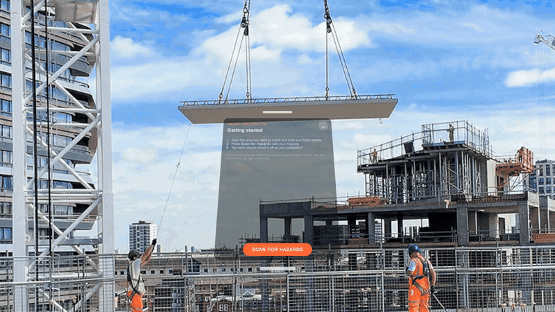
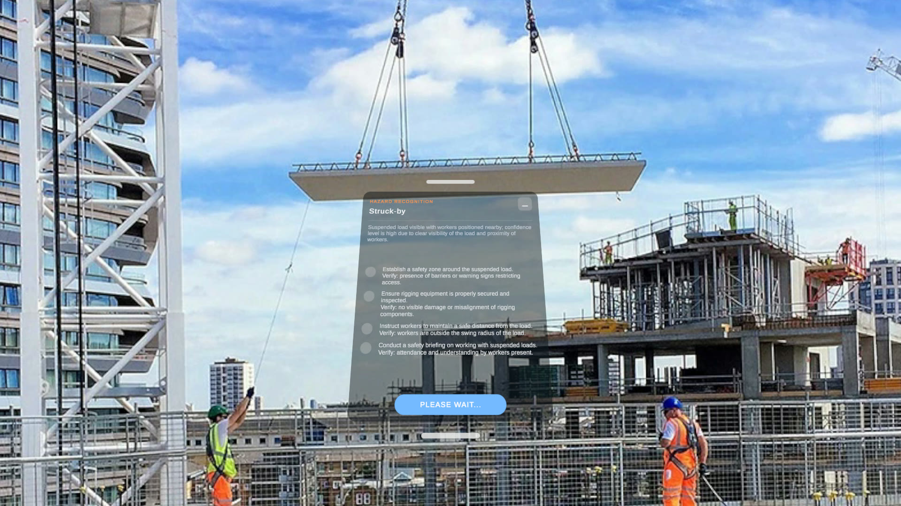
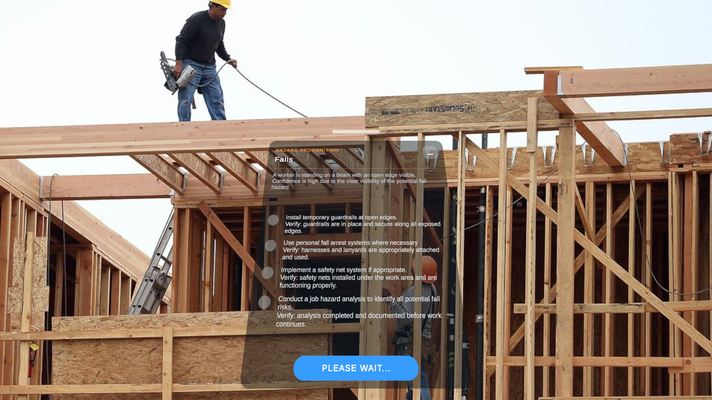
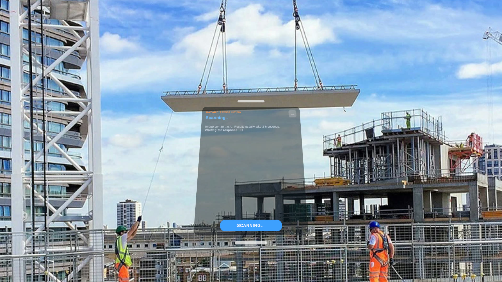
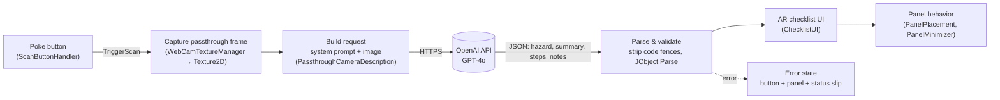

# AR Hazard Recognition

**A Meta Quest 3 mixed-reality app that looks at a construction scene through passthrough, asks GPT-4o what could hurt someone, and pins an OSHA Focus Four mitigation checklist in the user's view.**




<sub>Unity editor capture of the real app. The photo stands in for the Quest passthrough feed; the checklist is the actual GPT-4o response, rendered by the app's UI. Interactions were scripted in the editor (the white dot marks the fingertip). Full 36-second walkthrough, including moving and minimizing the panel and a second scan: [walkthrough.mp4](Docs/media/walkthrough.mp4).</sub>

---

## Overview

Most construction deaths in the U.S. come from four hazards that OSHA calls the **Focus Four**: falls, struck-by, caught-in/between, and electrocution. Recognizing them on a busy site depends on training, experience, and attention, and all three are in short supply when someone is new to the job or focused on a task.

This app puts a second set of eyes in the headset. The worker presses a button floating in front of them; the app takes the current passthrough camera frame, sends it to GPT-4o with a hazard-recognition prompt, and shows back:

- the **hazard category** it can see evidence for (e.g. *Struck-by*),
- a one- or two-sentence **summary** of the visual cue and how confident the model is, and
- an interactive **mitigation checklist**, where every step ends in a physical *Verify:* check.

It was built as part of my PhD research in Industrial and Systems Engineering (human factors) at NC State, and was presented as a live demo at the **Human Factors Extended Reality Showcase** at the HFES Annual Meeting in October 2026 ([see Publication](#publication)).

| Struck-by (suspended load) | Falls (open framing edge) |
|---|---|
|  |  |
| **Scanning state** | **Minimized to a status slip** |
|  |  |

## Features

- **No controllers required**: everything works with hand tracking (controllers are optional).
- **One-press scan**: poke the button directly or click it from a distance (hover, press, and release states; short cooldown against double scans).
- **Passthrough capture** of the left headset camera through Meta's Passthrough Camera API.
- **GPT-4o vision analysis** with a precision-first prompt restricted to the OSHA Focus Four taxonomy, returning strict JSON.
- **Interactive checklist**: tap to check a step; completed steps are struck through, faded, and moved below the open ones.
- **World-locked panel with lazy follow**: it stays put while you look around, glides back if you walk away or leave it out of view, and can be grabbed by its handle (up close or from a distance) and moved closer or farther.
- **Minimize to a status slip** ("No scan yet" / "Scanning…" / "Checklist ready" / "Scan failed") so the panel doesn't block the work area.
- **Plain-language error states** for a missing or rejected API key, no internet, rate limits, empty credit, timeouts, and unreadable responses.

## Architecture



The response contract the prompt enforces:

```json
{
  "hazard": "falls | struck_by | caught_in_between | electrocution | other",
  "summary": "1–2 sentences on the visible cue and confidence",
  "steps": [{ "id": 1, "text": "Imperative action. Verify: <observable check>", "done": false }],
  "notes": ["optional observations that did not pass the evidence gate"]
}
```

## Tech stack

| Area | Used |
|---|---|
| Engine | Unity 6000.2.8f1 (Unity 6.2), built-in render pipeline, C# |
| XR | Unity XR / OpenXR 1.15.1, Meta XR SDK 81, Meta Interaction SDK 78, Meta MR Utility Kit 78 |
| Camera | Meta Passthrough Camera API (via Meta's `PassthroughCamera` sample layer, MIT) |
| AI | OpenAI GPT-4o (vision) through [`com.openai.unity`](https://github.com/RageAgainstThePixel/com.openai.unity) 8.6.5 (OpenUPM) |
| UI | uGUI + TextMeshPro on world-space canvases |
| Device | Meta Quest 3 (Android / Horizon OS) |

## Human factors design choices

**No controllers needed.** The app runs entirely on hand tracking, so a worker doesn't have to carry or hold anything to use it, and their hands stay free between interactions. Controllers work too, for anyone who prefers them.

**A button you can see, touch, or reach from a distance.** Starting a scan is a large button in the panel: push it directly with a fingertip, or point at it and pinch from a distance. A visible button is easier to discover and explain to a first-time user than a memorized gesture, and the hover/press/release color changes confirm the input before anything happens. The panel itself works the same way: grab its handle up close, or grab it from a distance, and put it where it's comfortable.

**A checklist, not a paragraph.** The output is written to be *acted on*. Each step starts with a verb and ends with a *Verify:* check you can see or touch, so the list doubles as an inspection aid. Checking a step strikes it through and moves it to the bottom, so the work that's left is always at the top of the panel.

**Precision over recall.** A tool that cries wolf gets ignored. The prompt only allows hazards with a cue "a reviewer could literally circle in the image," bans claims of absence ("no guardrail") unless the view really shows it, and asks for "not clearly visible from this view" instead of guessing. Prompts were refined over **8 rounds of evaluation against about 50 expert-annotated images**.

**Staying aware of the surroundings.** Because the app runs in passthrough, the user keeps seeing the real site while they read and work through the checklist; the panel is a small overlay, not a replacement for their view.

**Placement in the field of view.** The panel spawns about 0.6 m in front of the user and slightly below eye level, so it sits under the line of sight rather than on top of the hazard being inspected. It's world-locked (it doesn't swim with every head turn), but it follows lazily: if the user walks more than 1.5 m away or leaves it out of view for 3 seconds, it glides back. Wherever the user drags it becomes the new preferred distance and height, and it can be minimized to a small status slip when they need a clear view.

**Honest system status.** The user always knows what the system is doing: a scanning message with expected wait time ("Results usually take 3–6 seconds"), a status slip when minimized, and failures explained in a sentence ("Couldn't reach OpenAI. Check that the headset is connected to Wi-Fi") rather than a silent nothing.

## Setup

### Requirements
- Unity **6000.2.8f1** with **Android Build Support** (OpenJDK, Android SDK & NDK)
- A **Meta Quest 3 or 3S** in [developer mode](https://developers.meta.com/horizon/documentation/native/android/mobile-device-setup/), on a Horizon OS version that supports the Passthrough Camera API
- An **OpenAI API key** with access to GPT-4o and some billing credit

### 1. Clone and open
```bash
git clone https://github.com/ehfang/ar-hazard-recognition.git
```
Open the folder in Unity Hub with 6000.2.8f1. Packages resolve automatically (the OpenAI package comes from the OpenUPM scoped registry already listed in `Packages/manifest.json`).

### 2. Create your own `OpenAIConfiguration` asset
The API key file is **not** in this repository (`Assets/Resources/OpenAIConfiguration.asset` is git-ignored). Create your own:

1. In the Project window, right-click `Assets/Resources` → **Create → OpenAI → OpenAIConfiguration**. Keep the name `OpenAIConfiguration`.
2. Select it and paste your API key in the Inspector.
3. Open `Assets/_Project/Scenes/ar-hazard.unity`, select the **Passthrough Camera Description** object, and drag your new asset into its **Configuration** field.

> ⚠️ Anything in `Assets/Resources` is packed into the APK, so a key stored this way can be extracted from the build. That's fine for a personal research prototype; don't distribute builds with your key in them. See [Limitations](#limitations-and-future-work).

### 3. Build and run
1. **File → Build Profiles**, switch to **Android**, and make sure `ar-hazard` is the only scene in the list.
2. Connect the Quest over USB and choose **Build And Run**.
3. On first launch, allow the **headset camera** permission.
4. Look at a scene and poke **SCAN FOR HAZARDS**.

## Project structure

```
Assets/
├── _Project/                         ← everything written for this app
│   ├── Scenes/ar-hazard.unity        main (and only) scene
│   ├── Scripts/
│   │   ├── HazardAnalysis/
│   │   │   ├── PassthroughCameraDescription.cs   capture → GPT-4o → parse → UI; error mapping
│   │   │   └── PassthroughCameraDisplay.cs       debug: shows a camera snapshot on a quad
│   │   ├── UI/
│   │   │   ├── ScanButtonHandler.cs              pokeable scan button + scan status
│   │   │   ├── ChecklistUI.cs                    builds and orders the interactive checklist
│   │   │   ├── PanelPlacement.cs                 world-locked panel with lazy follow
│   │   │   ├── PanelMinimizer.cs                 minimize / expand to a status slip
│   │   │   └── ContentToggler.cs                 makes the panel visible at startup
│   │   └── Interaction/
│   │       └── PointerRayVisual.cs               optional soft pointer ray (not in the scene)
│   ├── Prefabs/                      checklist row prefabs
│   ├── UI/Sprites/                   checkbox and rounded-rect sprites
│   └── Materials/
├── ThirdParty/
│   └── MetaPassthroughCamera/        Meta's Passthrough Camera API helper layer (MIT, see its LICENSE.txt)
├── Resources/                        Meta/OVR runtime settings (+ your git-ignored OpenAIConfiguration)
└── Oculus/ MetaXR/ XR/ XRI/ Plugins/ TextMesh Pro/   SDK-generated settings
Docs/media/                           screenshots and walkthrough video for this README
```

## Limitations and future work

- **Tied to one hosted model.** The request is built directly against GPT-4o, and OpenAI is retiring the GPT-4o API in **January 2027**. The next step is a **model-agnostic** interface: one hazard-analysis contract (image in, the JSON above out) with swappable backends.
- **Local, open-weight option.** Sending site photos to a third-party API raises privacy and connectivity issues (workers' faces, client property, poor signal on site). A local or on-premises open-weight vision model would keep images on the device or the company network.
- **API key in the client.** The key ships inside the app. A real deployment would put a small proxy service between the headset and the model provider.
- **One frame, one category.** Each scan looks at a single still and reports one primary hazard category, although the prompt allows the model to describe up to a few distinct hazards. Multi-frame and multi-hazard output are natural extensions.
- **Steps aren't always physically verifiable.** The prompt asks for observable checks, but the model sometimes returns administrative ones (e.g. "Verify: documentation of recent training sessions").
- **Latency.** A scan takes a few seconds and needs Wi-Fi.
- **Not a safety device.** This is a research prototype to support hazard recognition. It doesn't replace a competent person, site inspections, or training.

## Evaluation data

The prompt was evaluated against images drawn from the **OSHA Training Institute's Construction Focus Four hazard recognition training materials** (falls, struck-by, caught-in/between, electrocution), annotated by experts. Those materials are not redistributed in this repository.

> Source: OSHA Training Institute, *Construction Focus Four Training* (Falls, Struck-By, Caught-In or -Between, Electrocution). U.S. Department of Labor, Occupational Safety and Health Administration.

## Publication

This app was presented as **Demonstration 4, "Augmented Reality Hazard Detection: An AI-Assisted Approach to Construction Safety,"** in the HFES 2026 Extended Reality Showcase. The proceedings entry describes the scan button, OpenAI-based hazard flagging with an in-view mitigation checklist centered on OSHA's Focus Four, and the goal of letting users work through the checklist while staying aware of their surroundings.

> Chen, K. B., Alabi, C., Bailey, S. K. T., Fang, E., Fussell, S. G., Harris, J., Akash, K., & Wu, L. (2026). Human Factors Extended Reality Showcase 2026. *Proceedings of the Human Factors and Ergonomics Society Annual Meeting*. https://doi.org/10.1177/10711813261498754

## Author

**Emily Fang**: PhD student, Industrial and Systems Engineering (human factors), NC State University

[LinkedIn](https://www.linkedin.com/in/ehfang/) · [ehfang.github.io](https://ehfang.github.io)

## Acknowledgments

- Meta's [Unity Passthrough Camera API samples](https://github.com/oculus-samples/Unity-PassthroughCameraApiSamples) (MIT) for the camera access layer in `Assets/ThirdParty/MetaPassthroughCamera`.
- [`com.openai.unity`](https://github.com/RageAgainstThePixel/com.openai.unity) by RageAgainstThePixel for the OpenAI client.

## License

© 2026 Emily Fang. All rights reserved.

Third-party components keep their own licenses: Meta's Passthrough Camera API helper layer in `Assets/ThirdParty/MetaPassthroughCamera` is MIT-licensed (see its `LICENSE.txt`), and packages installed through the Unity Package Manager are covered by their respective licenses.
